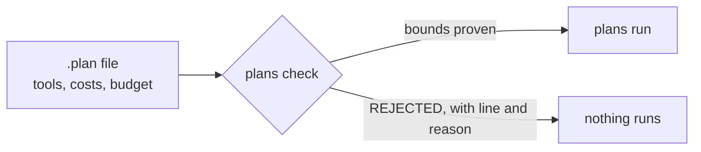

# plans

> Checked plans: an agent plan declares the tools it may call with costs and budgets, and a checker proves the bounds before the plan runs.

<!-- readme:status:start -->
**Active**. I work on it this month.
<!-- readme:status:end -->

Early: one crate, no release, not on crates.io.



## Why

Agents that call paid or slow tools can loop or fan out until the bill arrives. A runtime limit stops them after the cost is spent. I want the answer before the run: this plan cannot call `fetch` more than 5 times or cost more than 30, or it is rejected.

## What it does

- Declares tools with a cost and a per-tool and total budget in a small `.plan` language ([language reference](docs/plan-language.md)).
- Proves an upper bound on every tool's calls and on total cost, then compares it with the budget.
- Requires `fuel` on every `while` and `max` on every loop over a list; rejects recursion.
- Bounds `if` per path, so two exclusive branches are not summed: `examples/exclusive.plan` is 21 by paths where the older elementwise rule says 33.
- Runs an accepted plan against fake tools and reports actual calls next to the bound.

Not here: real tool calls, an MCP tool manifest, a package on crates.io.

## Quick start

```bash
cargo build
cargo run -- check examples/retry.plan
cargo run -- run examples/retry.plan
cargo run -- table examples/*.plan examples/bad/*.plan
cargo run -- check examples/bad/c_recursion.plan   # exits 1: recursion is not allowed
```

`check` and `run` print the bounds; `table` prints one Markdown row per plan. Exit code 1 means rejected, 2 means a usage or file error.

Output of `plans check examples/retry.plan`:

```text
examples/retry.plan: OK, proven within budget
  fetch        bound 5    budget 5
  log          bound 1    budget 1
  total cost   bound 21   budget 30
```

## How it works

The checker computes, for every path through the plan, how many times each tool is called, drops paths that another path dominates, and takes the costliest remaining path as the total. Loops scale their body by `max`, `fuel` or the range. Past 64 paths it merges to an elementwise maximum, which is looser but still sound. The reasoning and the alternatives are in [ADR 0001](docs/adr/0001-checked-plans.md).

## Numbers

- 24 tests, from `cargo test`.
- 7 good plans under `examples/` and 5 rejected ones under `examples/bad/`, counted with `ls`. A test walks both directories, so CI checks each rejection against its stated reason.

## Roadmap

Milestone 3, an MCP tool manifest, waits for a consumer. Nothing else is planned.

## Docs

- [docs/plan-language.md](docs/plan-language.md): the `.plan` syntax.
- [docs/adr/0001-checked-plans.md](docs/adr/0001-checked-plans.md): why the language has this shape, and when to stop.
- [CLAUDE.md](CLAUDE.md): commands and rules for contributors and agents.

MIT, see [LICENSE](LICENSE).
